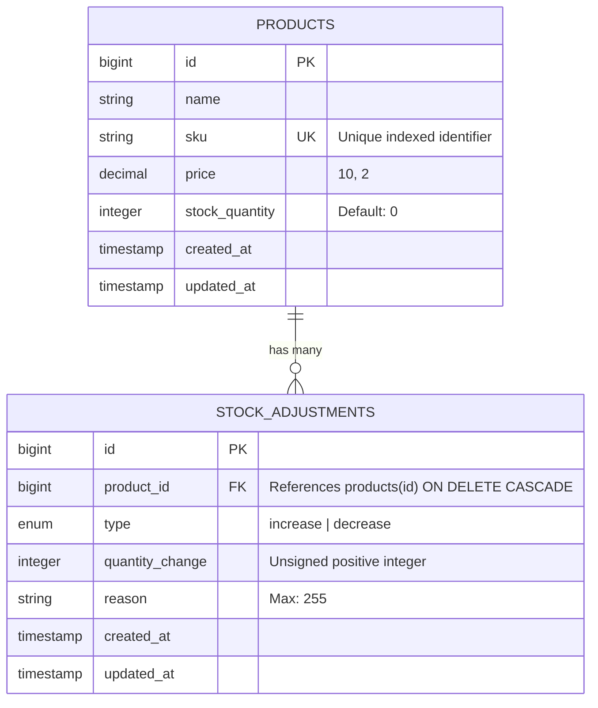

# Mini Inventory Management Module

[](https://laravel.com)
[](https://react.dev)
[](https://inertiajs.com)
[](https://tailwindcss.com)
[](https://pestphp.com)
[](https://php.net)

A robust, enterprise-grade **Mini Inventory Management Module** developed with **Laravel 13**, **Inertia.js (React 19)**, **TypeScript**, and **Tailwind CSS v4**. Built with concurrency safety, strict separation of concerns, the Strategy design pattern, and a high-contrast, polished Light Mode UI.

---

## Table of Contents

- [Overview & Key Features](#overview--key-features)
- [Architectural Decisions & Design Patterns](#architectural-decisions--design-patterns)
  - [1. Layered Architecture & Separation of Concerns](#1-layered-architecture--separation-of-concerns)
  - [2. Strategy Pattern for Stock Adjustments](#2-strategy-pattern-for-stock-adjustments)
  - [3. Concurrency Safety with Pessimistic Locking](#3-concurrency-safety-with-pessimistic-locking)
  - [4. Query Encapsulation with Eloquent Local Scopes](#4-query-encapsulation-with-eloquent-local-scopes)
  - [5. DRY Principles & Frontend Component Reusability](#5-dry-principles--frontend-component-reusability)
- [Database Schema & ER Design](#database-schema--er-design)
- [Tech Stack](#tech-stack)
- [Prerequisites](#prerequisites)
- [Step-by-Step Installation & Setup](#step-by-step-installation--setup)
- [Database Seeding](#database-seeding)
- [Running Automated Tests](#running-automated-tests)
- [Code Style & Static Analysis](#code-style--static-analysis)
- [Directory Structure](#directory-structure)

---

## Overview & Key Features

### Product Catalog & Lifecycle Management
- **Full Product CRUD:** Create, read, update, and safely delete inventory items.
- **Strict Business Validation:** Unique SKU enforcement (with self-exclusion on updates), numeric price formatting, and positive initial stock enforcement.
- **Safety Deletion Guard:** Products with stock on hand (`stock_quantity > 0`) cannot be deleted, preventing accidental physical inventory loss.

### Real-Time Search & Multi-Tier Stock Filtering
- **Full-Text Filter:** Instant live search across product names and SKUs.
- **Categorical Stock Status Filter:**
  - `In Stock` (quantity $\ge$ 10)
  - `Low Stock` (quantity 1 – 9)
  - `Out of Stock` (quantity = 0)
- **State Preservation:** Search terms and active status filters are automatically retained across pagination links without state loss.

### Concurrency-Safe Stock Adjustments
- **Atomic Operations:** Adjustments (`increase` or `decrease`) execute inside isolated database transactions.
- **Race Condition Prevention:** Utilizes pessimistic row locking (`SELECT ... FOR UPDATE`) to guarantee consistency in high-concurrency environments.
- **Negative Stock Prevention:** Decreases exceeding available inventory are rejected at both the Strategy level and UI preview level.

### Live UI & User Experience
- **Interactive KPI Metric Cards:** Real-time summary cards for total products and stock health breakdown that double as quick filters.
- **Live Stock Calculator:** Modal preview displaying `Current Stock ± Change = Projected Stock` before confirmation.
- **Smart SKU Generator:** Single-click intelligent SKU generator derived from product naming conventions.
- **Immutable Audit Trail:** Chronological timeline modal displaying adjustment quantities, operators, notes/reasons, and timestamps.

---

## Architectural Decisions & Design Patterns

### 1. Layered Architecture & Separation of Concerns

To avoid monolithic codebases and adhere to the Single Responsibility Principle (SRP):
- **Form Requests:** All incoming payload validation and custom error messages reside in dedicated request classes (`StoreProductRequest`, `UpdateProductRequest`, `AdjustStockRequest`).
- **Thin Controllers:** `ProductController` does not contain business logic or raw SQL queries; it orchestrates requests, interacts with services, and delegates responses.
- **Service Layer:** `InventoryService` manages the business workflow, database transactions, locking mechanisms, and audit persistence.
- **Presentation Layer:** React components focus exclusively on user experience, state management, and rendering.

```
Request (HTTP)
   │
   ▼
[FormRequest] ──► Server-side validation & error formulation
   │
   ▼
[ProductController] ──► Thin coordinator (Dependency Injection)
   │
   ▼
[InventoryService] ──► DB Transaction + Pessimistic Lock (lockForUpdate)
   │
   ▼
[Strategy Pattern] ──► IncreaseStockStrategy / DecreaseStockStrategy
   │
   ▼
[Eloquent Models] ──► Product (Local Scopes) & StockAdjustment (Audit)
   │
   ▼
Response (Inertia SPA JSON/Props) ──► React 19 Frontend
```

### 2. Strategy Pattern for Stock Adjustments

Stock adjustments vary in business rules (restocking additions vs. sales/damage deductions). Rather than utilizing fragile conditionals (`if/else` or `switch`), we implemented the **Strategy Pattern**:

- **Contract:** `App\Strategies\StockAdjustment\StockAdjustmentStrategy` specifies `calculateNewStock(int $currentStock, int $quantity): int`.
- **Implementations:**
  - `IncreaseStockStrategy`: Applies positive increments (`$currentStock + $quantity`).
  - `DecreaseStockStrategy`: Validates sufficiency; throws a `ValidationException` if `$quantity > $currentStock`, otherwise deducts stock.
- **Factory:** `StockAdjustmentStrategyFactory::make(string $type)` instantiates the concrete strategy dynamically, adhering strictly to the **Open/Closed Principle (OCP)**.

### 3. Concurrency Safety with Pessimistic Locking

In multi-user warehouses, concurrent adjustments on the same product could lead to the classic "lost update" problem or negative stock anomalies.

We resolved this by combining **Atomic Database Transactions** with **Pessimistic Row-Level Locking**:

```php
DB::transaction(function () use ($product, $type, $quantity, $reason) {
    // Acquire exclusive row lock
    $lockedProduct = Product::where('id', $product->id)
        ->lockForUpdate()
        ->firstOrFail();

    $strategy = StockAdjustmentStrategyFactory::make($type);
    $newStock = $strategy->calculateNewStock($lockedProduct->stock_quantity, $quantity);

    $lockedProduct->update(['stock_quantity' => $newStock]);

    $lockedProduct->adjustments()->create([
        'type' => $type,
        'quantity_change' => $quantity,
        'reason' => $reason,
    ]);

    return $lockedProduct;
});
```

### 4. Query Encapsulation with Eloquent Local Scopes

Query conditions for search and stock status ranges are centralized in `App\Models\Product`:
- `scopeSearch($query, ?string $term)`: Scopes matches across `name` and `sku`.
- `scopeFilterByStatus($query, ?string $status)`: Enforces consistent definitions for `in_stock` ($\ge 10$), `low_stock` ($1 - 9$), and `out_of_stock` ($= 0$) across controllers, seeders, and test suites.

### 5. DRY Principles & Frontend Component Reusability

- **Unified Create & Edit Modal:** Creation and editing share a single dynamic modal (`isProductModalOpen`, `editingProduct`), avoiding 100+ lines of duplicated form JSX.
- **Reusable `FormField` Component:** Standardized text/number inputs handling labels, required asterisks, focus states, inline validation errors, helper descriptions, and right-aligned actions (e.g. SKU generator).
- **Reusable `StockBadge` Component:** Centralized badge component applying semantic color coding across all inventory listings.
- **Declarative KPI Render:** Metric cards are rendered via a configuration array map rather than repetitive markup blocks.

---

## Database Schema & ER Design



---

## Tech Stack

| Technology | Version | Purpose |
| :--- | :--- | :--- |
| **PHP** | 8.3 / 8.5 | Backend Runtime |
| **Laravel** | 13.x | Core Application Framework |
| **MySQL / MariaDB** | 8.0+ | Relational Storage & Row-Level Locking |
| **Inertia.js** | 3.x | Monolithic SPA Architecture |
| **React** | 19.x | Frontend UI Library |
| **TypeScript** | 5.7+ | Static Type Safety |
| **Tailwind CSS** | 4.x | Utility-First Styling (High-Contrast Light Theme) |
| **Pest PHP** | 5.x | Feature & Unit Testing Suite |
| **Pint** | 1.x | Code Style Automation |

---

## Prerequisites

Before setting up the project, ensure you have the following installed on your machine:
- **PHP** $\ge$ 8.3 with extensions: `pdo`, `pdo_mysql`, `bcmath`, `mbstring`, `xml`, `ctype`, `curl`
- **Composer** $\ge$ 2.x
- **Node.js** $\ge$ 20.x & **npm**
- **MySQL** $\ge$ 8.0 or compatible database engine

---

## Step-by-Step Installation & Setup

### 1. Clone the Repository
```bash
git clone <repository-url> mini_task
cd mini_task
```

### 2. Install Dependencies
```bash
# Install PHP dependencies
composer install

# Install JavaScript dependencies
npm install
```

### 3. Configure Environment Variables
Copy the environment template and generate the application encryption key:
```bash
cp .env.example .env
php artisan key:generate
```

Configure your database connection parameters in `.env`:
```dotenv
DB_CONNECTION=mysql
DB_HOST=127.0.0.1
DB_PORT=3306
DB_DATABASE=mini_task
DB_USERNAME=your_mysql_username
DB_PASSWORD=your_mysql_password
```

### 4. Run Migrations & Seeders
Execute the database migrations and seed realistic sample products:
```bash
php artisan migrate --seed
```

### 5. Build Frontend Assets
Compile frontend assets with Vite:
```bash
npm run build
```

### 6. Start the Application Server
Run the local development server:
```bash
# Option A: Standard PHP development server
php artisan serve

# Option B: Run development watcher (Hot Module Reloading)
composer run dev
```

Visit the application in your browser at:
```
http://localhost:8000
```
*(The root `/` route will automatically redirect to the inventory management catalog at `/products`.)*

---

## Database Seeding

The application ships with a dedicated `ProductSeeder` that creates 12 realistic products across all inventory categories:
- **In Stock Items ($\ge$ 10 units):** e.g., *Logitech MX Master 3S Mouse (45 units)*, *Dell UltraSharp 27" 4K Monitor (18 units)*
- **Low Stock Items (1 – 9 units):** e.g., *Sony WH-1000XM5 Headphones (4 units)*, *Keychron K2 Wireless Keyboard (2 units)*
- **Out of Stock Items (0 units):** e.g., *Herman Miller Aeron Chair (0 units)*

Each seeded product is accompanied by realistic, initial audit history records in the `stock_adjustments` ledger.

To reseed the database at any time:
```bash
php artisan migrate:fresh --seed
```

---

## Running Automated Tests

The application features comprehensive automated test coverage with **Pest PHP**:
- **Product Management Tests:** CRUD workflows, unique SKU validation, deletion protection with active inventory, query search, and stock status filters.
- **Stock Adjustment Tests:** Positive increments, negative deductions, audit logging accuracy, negative stock rejection, and concurrency isolation.

Execute the entire test suite:
```bash
php artisan test --compact
```
*(All 110 tests across the application pass cleanly.)*

To run inventory-specific tests:
```bash
php artisan test tests/Feature/ProductManagementTest.php
php artisan test tests/Feature/StockAdjustmentTest.php
```

---

## Code Style & Static Analysis

Ensure code formatting matches project standards:
```bash
# Format PHP files according to Laravel guidelines
vendor/bin/pint --format agent

# Perform static type checking on TypeScript code
npm run types:check
```

---

## Directory Structure

```
mini_task/
├── app/
│   ├── Http/
│   │   ├── Controllers/
│   │   │   └── ProductController.php          # Thin orchestrator controller
│   │   └── Requests/
│   │       ├── AdjustStockRequest.php         # Stock adjustment validation
│   │       ├── StoreProductRequest.php        # Product creation validation
│   │       └── UpdateProductRequest.php       # Product update validation
│   ├── Models/
│   │   ├── Product.php                        # Scopes: search, filterByStatus
│   │   └── StockAdjustment.php                # Immutable audit ledger model
│   ├── Services/
│   │   └── InventoryService.php               # Transactions & lockForUpdate logic
│   └── Strategies/
│       └── StockAdjustment/
│           ├── StockAdjustmentStrategy.php       # Strategy contract interface
│           ├── IncreaseStockStrategy.php         # Stock addition strategy
│           ├── DecreaseStockStrategy.php         # Stock deduction strategy
│           └── StockAdjustmentStrategyFactory.php# Dynamic strategy resolver
├── database/
│   ├── factories/
│   │   └── ProductFactory.php                 # inStock, lowStock, outOfStock states
│   ├── migrations/
│   │   ├── *_create_products_table.php
│   │   └── *_create_stock_adjustments_table.php
│   └── seeders/
│       ├── DatabaseSeeder.php
│       └── ProductSeeder.php                  # 12 realistic catalog products
├── resources/
│   └── js/
│       ├── components/
│       │   └── inventory/
│       │       ├── FormField.tsx              # Reusable form field component
│       │       └── StockBadge.tsx             # Reusable stock status badge
│       └── pages/
│           └── products/
│               └── index.tsx                  # High-contrast Light Mode UI
├── routes/
│   └── web.php                                # Inventory module endpoints
└── tests/
    └── Feature/
        ├── ProductManagementTest.php          # 11 feature tests for catalog CRUD
        └── StockAdjustmentTest.php            # 7 tests for strategy & concurrency
```

---

## License

This project is open-sourced under the [MIT License](LICENSE).
